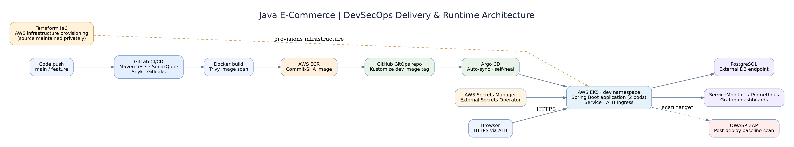
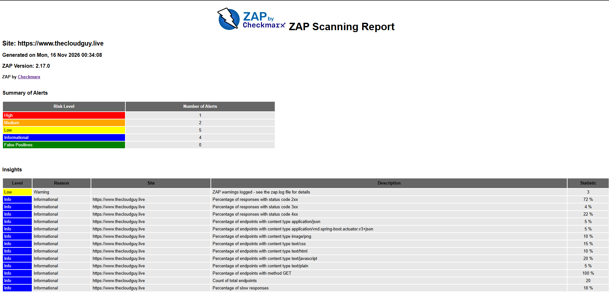
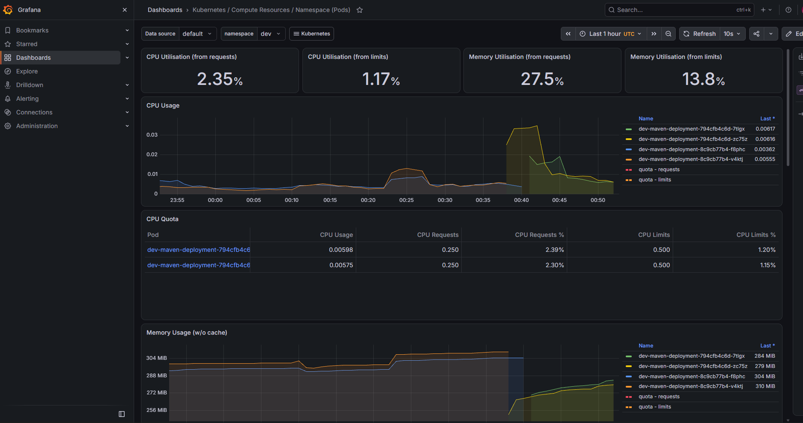

# Java E-Commerce DevSecOps Pipeline on AWS EKS

**Terraform-provisioned AWS infrastructure (private configuration) · Spring Boot · Maven · GitLab CI/CD · Docker · AWS ECR/EKS · Argo CD · Kubernetes · SonarQube · Snyk · Gitleaks · Trivy · OWASP ZAP · Prometheus/Grafana**

A hands-on DevSecOps portfolio project demonstrating the journey from a Java e-commerce application to a containerized Kubernetes deployment, with automated testing, multiple security scans, GitOps delivery, externalized secrets, and operational monitoring.

> **Training environment, not a production security claim.** Some security-scanning settings intentionally report findings without blocking the release. The supplied ZAP report includes alerts that need triage. See [Security notes](#security-notes).

## At a glance

| Area | Implementation |
| --- | --- |
| Application | Java 21, Spring Boot 3.5.16, Maven; NEXORA storefront and REST APIs |
| Persistence | PostgreSQL, Spring Data JPA, Flyway migrations |
| Identity | JWT-based authentication; customer and admin roles |
| CI/CD | GitLab stages for tests, source scans, build, image scan, publish, deployment and DAST |
| Infrastructure | AWS infrastructure provisioned with Terraform; Terraform source is intentionally kept private and is not part of this repository |
| Container delivery | Multi-stage Dockerfile (non-root runtime), AWS ECR, commit-SHA image tags |
| Deployment | Kubernetes dev overlay (Kustomize), Argo CD auto-sync, AWS ALB Ingress |
| Secrets | AWS Secrets Manager integration with External Secrets Operator manifests |
| Monitoring | Spring Boot Actuator/Micrometer, Prometheus ServiceMonitor, Grafana |

## Architecture



[View full-size architecture](docs/architecture/architecture.svg) · [View the GitOps repository](https://github.com/Odjeissi/gitops)

**Infrastructure as Code:** I provisioned the supporting AWS infrastructure using **Terraform**. The Terraform source is kept private and is not included in or linked from this repository. The diagram represents the infrastructure provisioned for this project, not publicly auditable Terraform code.

**Delivery path:** GitLab validates and builds code, scans a Docker image, and publishes the image to Amazon ECR on the default branch. The deployment job changes the image tag in the *separate* GitOps repository; Argo CD watches the `overlays/dev/` path and reconciles Kubernetes resources. The deployed Spring Boot service connects to an external PostgreSQL endpoint. An AWS ALB exposes the web application; Prometheus scrapes application metrics, and Grafana visualizes resources.

**Scope note:** The diagram illustrates configured components and the working deployment shown in screenshots. It does not assert a verified production environment or independently verified AWS database instance type.

## Evidence: CI/CD, GitOps, security, observability

### 1. Automated GitLab CI/CD


The pipeline in the provided screenshots completed **nine jobs** across seven stages:

| Stage | Job | Purpose |
| --- | --- | --- |
| `test` | `unit_tests` | Maven/JUnit tests; JUnit report artifact |
| `security` | `secrets_detection` | Gitleaks working-tree and Git-history detection |
| `security` | `sast_scan` | SonarQube Maven analysis and quality-gate wait |
| `security` | `sca_scan` | Snyk dependency analysis and JSON artifact |
| `build` | `docker_build` | Multi-stage Docker build and image artifact |
| `container_scan` | `trivy_image_scan` | Trivy image vulnerability scan and JSON results |
| `push` | `docker_push` | Docker image push to ECR using GitLab OIDC to assume an AWS IAM role |
| `deploy` | `dev_deploy` | Update image tag in GitHub GitOps repo |
| `dast_scan` | `dast_scan_job` | OWASP ZAP baseline against the deployed site |

**Branch policy (updated after the uploaded source snapshot):** Feature and default branches run validation (tests, SAST, SCA, secrets, Docker build and Trivy); only the default branch publishes an image, updates GitOps, and runs post-deploy DAST. The uploaded `code_source.zip` contains the earlier rules, while the newer configuration was provided separately and reported pushed to the repository. Confirm the committed GitLab configuration when reviewing current behavior. Merge-request pipelines are **not** enabled by the simplified branch-only `workflow` rules.

### 2. Kubernetes deployment and GitOps


- Argo CD `dev-maven-app` targets the `dev` namespace, with automated sync, pruning and self-healing enabled.
- Kustomize organizes reusable manifests under `k8s/base/` and the deployed environment under `k8s/overlays/dev/`.
- The base manifest declares three replicas; the **dev overlay patches the replica count to two**, as shown by the two running pods in Argo CD.
- Pod configuration includes startup, readiness and liveness probes; CPU/memory requests and limits; ConfigMap and Kubernetes Secret references.
- ALB Ingress is configured with HTTPS redirect, and ExternalDNS configuration is included.
- The `k8s/overlays/prod/` directory is empty in the supplied snapshot; this repository documents a **development deployment**, not a production rollout.

### 3. DAST and security-scanning evidence



The OWASP ZAP baseline job completed and uploaded its HTML report as a GitLab artifact.

| Severity | Alerts in supplied report |
| --- | ---: |
| High | 1 |
| Medium | 2 |
| Low | 5 |
| Informational | 4 |


A **green scan job does not mean zero vulnerabilities**. The report requires triage and remediation; its summary counts are a historical snapshot, not a live security status.

### 4. Application and cluster observability

| Grafana Kubernetes pod dashboard | Prometheus scrape health |
| --- | --- |
|  |  |


Spring Actuator/Micrometer exposes `/actuator/prometheus`. The provided `ServiceMonitor` scrapes the `dev` namespace at **15-second intervals**. Both application targets were **UP at the time of the screenshot**. The application also defines custom counters for order, payment and inventory events.

## Application capabilities

The application is a Java/Spring Boot monolith, not just deployment scaffolding:

- NEXORA storefront served from `src/main/resources/static/`, plus Swagger UI and REST endpoints.
- Account registration and login with JWT authentication and role-based access controls.
- Product catalog and administrative product/stock operations.
- Order creation, cancellation and **simulated** payment processing (no real payment provider).
- PostgreSQL transactions and pessimistic locking for inventory updates, reducing the risk of overselling during concurrent requests.
- Flyway-managed schema changes and seed data for development.
- JUnit/Mockito tests, PostgreSQL Testcontainers integration test, and JaCoCo reporting configuration.

## Repository structure

```text
maven_project/
├── README.md                          # This overview
├── code_source/
│   ├── .gitlab-ci.yml                # CI/CD pipeline (maintained in GitLab)
│   ├── pom.xml                       # Maven build, dependencies and plugins
│   ├── Docker/Dockerfile             # Multi-stage Java container
│   ├── compose.yaml                  # Local Spring Boot + PostgreSQL
│   ├── .env.example                  # Environment-variable template
│   └── src/
│       ├── main/java/               # Auth, product, order, security and metrics
│       ├── main/resources/static/    # NEXORA storefront
│       ├── main/resources/db/migration/
│       └── test/                     # Unit and integration tests
├── k8s/
│   ├── base/                         # Deployment, service, ingress, config
│   ├── overlays/dev/                 # Kustomize dev image tag + replica override
│   ├── argocd/                       # Argo CD Application
│   ├── eso/                          # External Secrets configuration
│   ├── external_dns_values/          # ExternalDNS values
│   ├── prometheus_stack/             # ServiceMonitor and stack values
│   ├── namespace/                    # Namespace definition
│   └── policies/                     # IAM policy examples
└── docs/
    ├── architecture/                # Architecture diagram
    └── screenshots/                 # Actual pipeline and monitoring evidence
```

## Run locally

**Prerequisites:** Docker/Compose; Java 21 and Maven if running tests directly. This example runs both the Spring Boot application and PostgreSQL in containers.

```bash
cd code_source
cp .env.example .env
# Edit .env to replace DB_PASSWORD and APP_JWT_SECRET_BASE64 placeholders.
# Generate a suitable JWT key using: openssl rand -base64 32
docker compose up --build -d
```

> Keep `.env` out of version control. For an admin bootstrap user, set `APP_ADMIN_EMAIL` and `APP_ADMIN_PASSWORD` in the environment. Flyway migrations execute when the application starts with a reachable database.

| Interface | Local address |
| --- | --- |
| NEXORA storefront | `http://localhost:8080/` |
| Swagger UI | `http://localhost:8080/swagger-ui.html` |
| Health | `http://localhost:8080/actuator/health` |
| Prometheus endpoint | `http://localhost:8080/actuator/prometheus` |

**Run unit tests:**

```bash
cd code_source
mvn clean test
```

**Integration tests:** An `integration-tests` Maven profile configures Failsafe; the Testcontainers tests require a running Docker engine. Snyk is also configured in the Maven lifecycle and may require `SNYK_TOKEN` for commands that reach its goals.

```bash
mvn verify -Pintegration-tests
```

## Security notes

The project integrates security tools to demonstrate the engineering workflow. The supplied configuration deliberately relaxes some enforcement:

| Scanner | Current learning-oriented behavior |
| --- | --- |
| SonarQube | Maven property `sonar.qualitygate.wait=true` |
| Snyk | `failOnIssues=false` (does not block solely for vulnerability findings) |
| Trivy | Report conversion uses `--exit-code 0` for HIGH/CRITICAL findings |
| OWASP ZAP | Baseline job uses `-I`; reported findings do not necessarily fail the job |

**Before treating this as production-ready:** triage the ZAP report (including its high-severity finding), enforce appropriate quality gates, review public actuator and Swagger access, validate ingress/security headers, scope IAM privileges, and confirm external secrets are healthy. In the supplied `ClusterSecretStore.yaml`, the committed `status` block contains `Ready: False` / `ValidationFailed`; that is not evidence of a currently healthy SecretStore and should be investigated or removed from desired-state manifests after fixing its cause.

## Design decisions and trade-offs

- **Why GitOps?** CI builds and publishes images; Argo CD reconciles the desired state separately from the build pipeline.
- **Why commit-based tags?** A Git SHA provides traceability between a pipeline commit, ECR image and the Kustomize deployment update.
- **Why OIDC for ECR?** GitLab uses a federated AWS role rather than storing a permanent AWS access key in the pipeline.
- **Why non-blocking scans?** During training, they enable learning end-to-end delivery while still collecting reports. They must not be mistaken for enforced security controls.
- **Why a dev overlay?** The base Kubernetes configuration is reusable while the development environment can override replica counts and image tags. The three-to-two replica override is intentional for training.
- **Why Terraform?** I used Infrastructure as Code to provision the AWS resources separately from application delivery. The source is deliberately private; the application and Kubernetes configuration are the focus of this repository.

## Related portfolio projects

- [AWS Three-Tier Infrastructure with Terraform](https://github.com/Odjeissi/aws-3tier-terraform)
- [Employee Management on AWS ECS](https://github.com/Odjeissi/Employee-Management-AWS-ECS)
- [AWS EKS / GitOps and Monitoring](https://github.com/Odjeissi/ks8)
