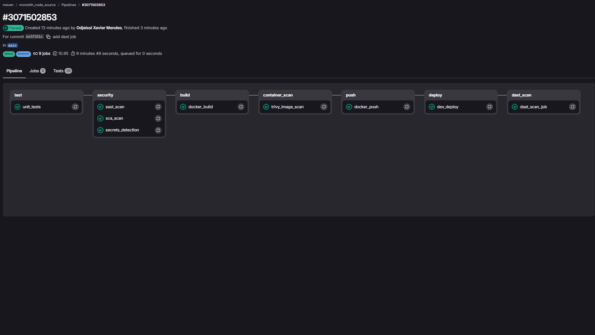
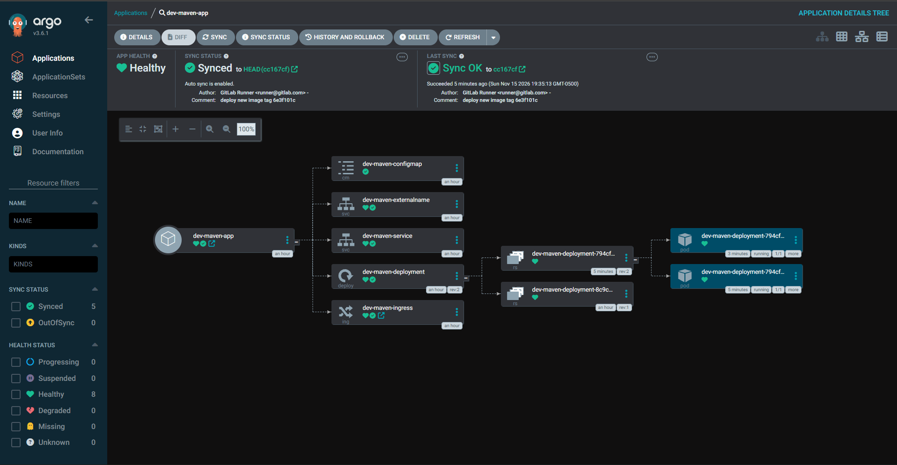
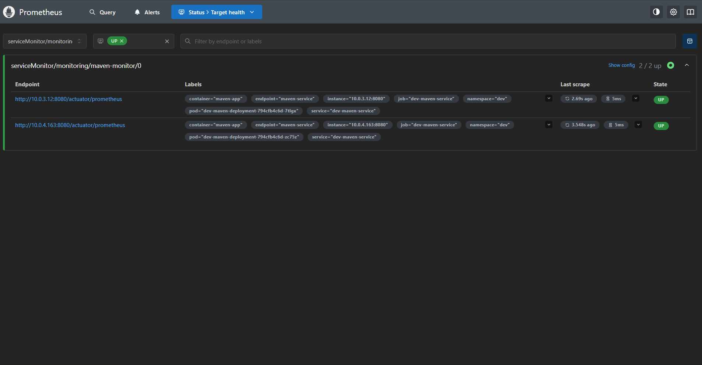
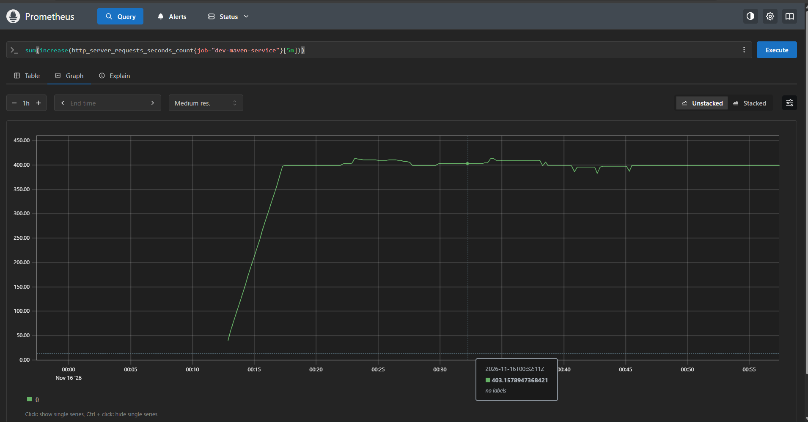
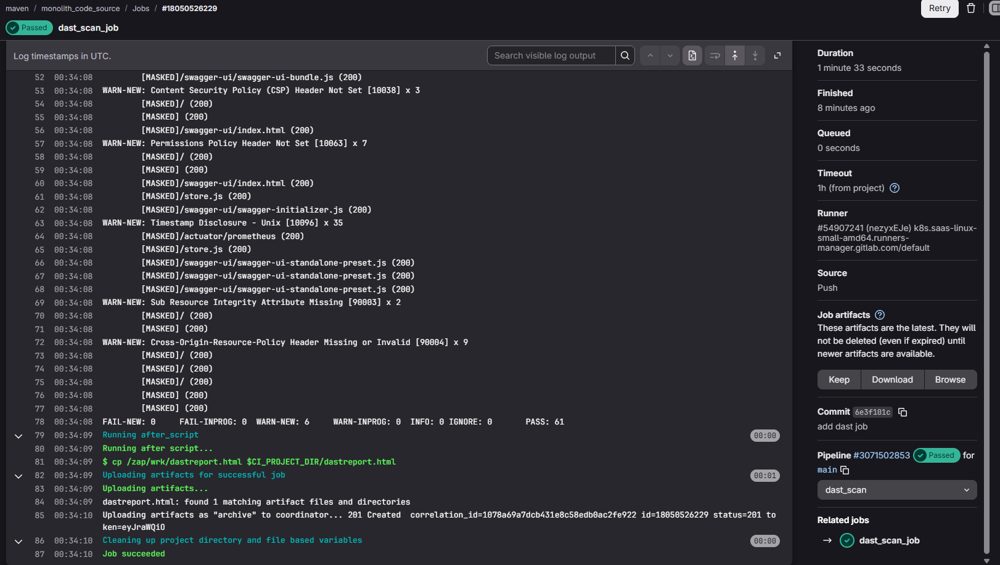

# Java E-Commerce DevSecOps Project

I built this project to practice deploying a Java application on AWS and automating the steps around it: testing, security scans, building Docker images, deploying to Kubernetes, and monitoring the app once it's running.

The application is a small e-commerce store called **NEXORA**. It uses Java 21, Spring Boot, Maven, and PostgreSQL. The main focus of this project was learning how to take an application from code to a running service on AWS EKS.

> This is a learning project, not a production setup. Some security checks are set to report issues without stopping the pipeline. I've included the scan results below.

## Architecture


**How it works:** I push code to GitHub, and GitLab CI/CD runs the tests and scans. The pipeline builds a Docker image and, on `main`, pushes it to Amazon ECR. It then updates the image tag in a separate [GitOps repository](https://github.com/Odjeissi/gitops). Argo CD picks up the change and syncs the app to EKS.

The AWS infrastructure was created using **Terraform**. I'm keeping the Terraform code private, so it isn't included in this repository.

## Tools used

| Area | Tools |
| --- | --- |
| Application | Java 21, Spring Boot, Maven, PostgreSQL, Flyway |
| Tests | JUnit, Mockito, Testcontainers, JaCoCo |
| CI/CD | GitLab CI/CD, Docker, Amazon ECR |
| Security | Gitleaks, SonarQube, Snyk, Trivy, OWASP ZAP |
| AWS and Kubernetes | Terraform (private), Amazon EKS, AWS ALB, Kustomize |
| GitOps | Argo CD |
| Secrets | AWS Secrets Manager, External Secrets Operator |
| Monitoring | Spring Boot Actuator, Prometheus, Grafana |

## The application

NEXORA includes a storefront and REST APIs. I added user registration and login using JWT, product and stock management, orders, and simulated payments. PostgreSQL stores the data, and Flyway handles database changes.

One feature I worked on was **inventory locking**. When orders are placed at the same time, the application uses database locks to help prevent selling more items than are in stock.

## GitLab CI/CD



The pipeline has nine jobs:

| Job | What it does |
| --- | --- |
| `unit_tests` | Runs Maven tests |
| `secrets_detection` | Checks for secrets with Gitleaks |
| `sast_scan` | Scans the Java code with SonarQube |
| `sca_scan` | Checks dependencies with Snyk |
| `docker_build` | Builds the Docker image |
| `trivy_image_scan` | Scans the image with Trivy |
| `docker_push` | Pushes the image to Amazon ECR |
| `dev_deploy` | Updates the image tag in the GitOps repo |
| `dast_scan_job` | Runs OWASP ZAP against the deployed app |

I updated the branch rules so that **tests, security scans, and the Docker build run on both feature branches and `main`**. Only `main` should push an image, update the GitOps repo, and run the deployed-app scan. The screenshot above is from a successful nine-job run before that rules update.

## Kubernetes and Argo CD



I use Kustomize to manage the Kubernetes files. The base Deployment has three replicas, and the **development overlay changes that to two**. I did this on purpose to practice using overlays for different environments.

Argo CD watches the GitOps repo and syncs the development environment. The manifests also include Services, an Ingress, ConfigMaps, health checks, resource limits, and External Secrets configuration.

The screenshot shows the development application healthy and synced with two running pods. I haven't set up a production overlay in this repository.

## Monitoring

I use Prometheus to collect metrics and Grafana to see how the application is doing. Spring Boot exposes metrics at `/actuator/prometheus`.

| Grafana dashboard | Prometheus targets |
| --- | --- |
|  |  |



The screenshots show Prometheus scraping both application pods and Grafana displaying CPU and memory usage.

## Security scans

I included security scans in the pipeline so I could learn how they fit into CI/CD, not just run them manually.


The ZAP report in this example found **1 high, 2 medium, 5 low, and 4 informational alerts**. Those findings still need to be reviewed. The job passed because I used training-friendly options that don't fail the pipeline for every reported issue.



A few important settings:

- **Snyk:** `failOnIssues=false`
- **Trivy:** `--exit-code 0` on the report step
- **ZAP:** `-I` to keep the baseline scan from blocking the job for reported alerts

These are useful while learning the whole workflow. For a real production pipeline, I'd review the findings and tighten the checks before deployment.

## Run it locally

You'll need Docker and Docker Compose. From the repository root:

```bash
cd code_source
cp .env.example .env
```

Edit `.env` with local database credentials and a JWT secret. You can generate a secret with:

```bash
openssl rand -base64 32
```

Then start the app and PostgreSQL:

```bash
docker compose up --build -d
```

Once the app is running:

| Page | URL |
| --- | --- |
| Storefront | http://localhost:8080/ |
| Swagger UI | http://localhost:8080/swagger-ui.html |
| Health check | http://localhost:8080/actuator/health |
| Prometheus metrics | http://localhost:8080/actuator/prometheus |

To run tests with Java 21 and Maven installed:

```bash
mvn clean test
```

For the integration-test profile, Docker is needed for Testcontainers:

```bash
mvn verify -Pintegration-tests
```

Some Maven runs may also need Snyk configuration, depending on which plugin goals execute. Don't commit your `.env` file or any secrets.

## Repository layout

```text
maven_project/
├── README.md
├── code_source/           # Java app, Maven, Docker, GitLab pipeline
├── k8s/
│   ├── base/              # Shared Kubernetes resources
│   ├── overlays/dev/      # Development settings
│   ├── argocd/            # Argo CD application
│   ├── eso/               # External Secrets configuration
│   └── prometheus_stack/  # Monitoring configuration
└── docs/
    ├── architecture/     # Architecture diagram
    └── screenshots/      # Screenshots from my setup
```

## What I learned

The biggest part of this project was connecting the tools together. I got more practice with Maven builds, security scans, Docker, AWS ECR, Kubernetes, GitOps, and monitoring. I also learned why it's important to understand what a **passed** pipeline actually means—especially when a scan can find issues without failing the job.

## Other projects

- [AWS 3-Tier Infrastructure with Terraform](https://github.com/Odjeissi/aws-3tier-terraform)
- [Employee Management on AWS ECS](https://github.com/Odjeissi/Employee-Management-AWS-ECS)
- [Kubernetes GitOps and Monitoring](https://github.com/Odjeissi/ks8)
